# Learning map

Every kata in suggested order. Top to bottom is beginner → expert; an arrow means "do this one first". Colour is the track.

```mermaid
flowchart TD
  subgraph L1 [Beginner]
    k01["01 mutable variable vs mutable reference"]
    k07["07 unwrap in a library"]
    k10["10 newtypes, not primitives"]
    k13["13 a missing trait bound"]
    k16["16 a std MutexGuard across await"]
    k32["32 str, not String"]
    k33["33 a status string to an enum"]
    k34["34 entry, not contains_key"]
    k35["35 iterate, don't index"]
    k36["36 test the edges"]
  end
  subgraph L2 [Intermediate]
    k02["02 moving out of a Vec"]
    k04["04 borrow, don't take"]
    k05["05 take, don't clone"]
    k08["08 question mark needs a From"]
    k11["11 bool flags to an enum"]
    k14["14 impl Trait vs dyn Trait"]
    k17["17 spawn, then send results back"]
    k19["19 one pool, made at startup"]
    k21["21 a bounded queue for untrusted input"]
    k22["22 a timeout on every network await"]
    k37["37 a closure bound stricter than the body needs"]
    k38["38 a RefCell borrow held across recursion"]
    k39["39 an RAII guard, not a manual release"]
    k40["40 an associated type, not a generic parameter"]
    k41["41 Rc across threads"]
    k42["42 no float money"]
    k46["46 quote with a spread"]
    k47["47 a stale quote accepted"]
    k51["51 a credit line overspent"]
    k53["53 a balance that never goes negative"]
    k59["59 a shared Mutex inside par_iter"]
    k74["74 sparse ids: a map, not a Vec"]
    k56["56 rayon inside async"]
    k57["57 untrusted JSON into checked newtypes"]
    k69["69 stream, don't slurp"]
    k70["70 a decimal string, parsed without a float"]
    k71["71 Read and Write, not a path"]
    k72["72 a bad-row policy"]
  end
  subgraph L3 [Advanced]
    k03["03 a struct outliving its reference"]
    k06["06 one lifetime too many"]
    k09["09 Option loses the why"]
    k12["12 typestate: consume self"]
    k15["15 inject, don't reach for a global"]
    k18["18 a lock held over a slow await"]
    k20["20 a sync driver on the async runtime"]
    k23["23 an untrusted length prefix"]
    k24["24 split reads from writes"]
    k25["25 a lagging client"]
    k26["26 generate, don't hand-write"]
    k27["27 a deadline on a stream"]
    k43["43 Relaxed is not enough"]
    k44["44 macro_rules!, not copy-paste"]
    k48["48 a multi-hop route"]
    k49["49 a batch with a remainder"]
    k50["50 an idempotent transfer"]
    k52["52 an order book sequence gap"]
    k55["55 a config snapshot, not a read per quote"]
    k58["58 graceful shutdown: signal, drain, join"]
    k61["61 a transactional outbox"]
    k62["62 out-of-order and duplicate events"]
    k73["73 shard by key, keep order"]
    k54["54 a Merkle sum tree"]
    k63["63 a generic method behind dyn"]
  end
  subgraph L4 [Expert]
    k28["28 unsafe to dodge the borrow checker"]
    k29["29 a safe API over raw pointers"]
    k30["30 a dangling CString across FFI"]
    k31["31 capstone: a concurrent cache"]
    k45["45 capstone: a mini order book"]
    k60["60 capstone: an async feed with parallel depth"]
  end

  k01 --> k02
  k02 --> k04
  k02 --> k05
  k01 --> k03
  k01 --> k32
  k01 --> k34
  k34 --> k74
  k01 --> k35
  k03 --> k06
  k07 --> k08
  k07 --> k36
  k35 --> k36
  k08 --> k09
  k08 --> k39
  k39 --> k29
  k10 --> k11
  k33 --> k11
  k11 --> k12
  k13 --> k14
  k14 --> k15
  k14 --> k63
  k13 --> k16
  k13 --> k37
  k02 --> k38
  k39 --> k38
  k16 --> k17
  k16 --> k18
  k17 --> k18
  k17 --> k19
  k19 --> k20
  k17 --> k21
  k17 --> k22
  k09 --> k23
  k17 --> k24
  k24 --> k25
  k21 --> k25
  k17 --> k26
  k26 --> k27
  k22 --> k27
  k07 --> k42
  k10 --> k42
  k13 --> k40
  k14 --> k40
  k02 --> k41
  k41 --> k43
  k17 --> k43
  k10 --> k44
  k42 --> k44
  k34 --> k49
  k42 --> k49
  k02 --> k28
  k03 --> k28
  k28 --> k29
  k28 --> k30
  k18 --> k31
  k21 --> k31
  k42 --> k45
  k42 --> k46
  k46 --> k47
  k46 --> k48
  k34 --> k45
  k20 --> k60
  k21 --> k60
  k52 --> k60
  k10 --> k60
  k12 --> k50
  k33 --> k50
  k47 --> k50
  k25 --> k52
  k50 --> k52
  k19 --> k61
  k50 --> k61
  k09 --> k61
  k50 --> k62
  k52 --> k62
  k53 --> k62
  k41 --> k51
  k42 --> k51
  k36 --> k53
  k10 --> k53
  k42 --> k53
  k15 --> k55
  k18 --> k55
  k41 --> k55
  k42 --> k54
  k09 --> k54
  k23 --> k54
  k17 --> k56
  k41 --> k56
  k35 --> k59
  k41 --> k59
  k10 --> k57
  k42 --> k57
  k53 --> k57
  k08 --> k69
  k35 --> k69
  k32 --> k70
  k42 --> k70
  k08 --> k71
  k13 --> k71
  k69 --> k71
  k08 --> k72
  k69 --> k72
  k71 --> k72
  k17 --> k73
  k21 --> k73
  k41 --> k73
  k17 --> k58
  k18 --> k58
  k22 --> k58

  classDef ownership fill:#fde2e2,stroke:#c0392b,color:#000
  classDef lifetimes fill:#fdebd0,stroke:#d35400,color:#000
  classDef errors fill:#fcf3cf,stroke:#b7950b,color:#000
  classDef apidesign fill:#d5f5e3,stroke:#1e8449,color:#000
  classDef traits fill:#d1f2eb,stroke:#117a65,color:#000
  classDef async fill:#d6eaf8,stroke:#2471a3,color:#000
  classDef db fill:#e8daef,stroke:#7d3c98,color:#000
  classDef security fill:#ebedef,stroke:#2c3e50,color:#000
  classDef websockets fill:#e0f7fa,stroke:#00838f,color:#000
  classDef grpc fill:#fce4ec,stroke:#ad1457,color:#000
  classDef unsafe fill:#424242,stroke:#000,color:#fff
  classDef capstone fill:#ffd700,stroke:#7a5c00,stroke-width:3px,color:#000
  classDef money fill:#f1f8e9,stroke:#558b2f,color:#000
  classDef quotes fill:#ffccbc,stroke:#4e342e,color:#000
  classDef iterators fill:#efebe9,stroke:#6d4c41,color:#000
  classDef collections fill:#e8eaf6,stroke:#3949ab,color:#000
  classDef enums fill:#f0f4c3,stroke:#827717,color:#000
  classDef strings fill:#fff8e1,stroke:#ff6f00,color:#000
  classDef macros fill:#ede7f6,stroke:#4527a0,color:#000
  classDef atomics fill:#fbe9e7,stroke:#bf360c,color:#000
  classDef threads fill:#e0f7e9,stroke:#00a86b,color:#000
  classDef generics fill:#e1f5fe,stroke:#01579b,color:#000
  classDef drop fill:#e3e8f0,stroke:#37474f,color:#000
  classDef closures fill:#e8e6f0,stroke:#5e50a1,color:#000
  classDef testing fill:#ffe0d6,stroke:#ff5722,color:#000
  classDef statemachines fill:#b39ddb,stroke:#311b92,color:#000
  classDef credit fill:#a5d6a7,stroke:#1b5e20,color:#000
  classDef rayon fill:#fff3e0,stroke:#e65100,color:#000
  classDef serde fill:#f5e6c8,stroke:#8d6e63,color:#000
  classDef io fill:#c5cae9,stroke:#1a237e,color:#000
  classDef concurrency fill:#b2dfdb,stroke:#004d40,color:#000
  classDef smartpointers fill:#bcaaa4,stroke:#3e2723,color:#000
  classDef routing fill:#90caf9,stroke:#0d47a1,color:#000
  classDef batching fill:#fff3e0,stroke:#e65100,color:#000
  classDef por fill:#fff9c4,stroke:#f57f17,color:#000
  classDef latency fill:#c5cae9,stroke:#1a237e,color:#000

  class k01,k02,k04,k05 ownership
  class k03,k06 lifetimes
  class k07,k08,k09,k72 errors
  class k10,k11,k12 apidesign
  class k13,k14,k15,k63 traits
  class k16,k17,k18,k58 async
  class k19,k20,k61 db
  class k21,k22,k23 security
  class k24,k25,k52 websockets
  class k26,k27 grpc
  class k28,k29,k30 unsafe
  class k31,k45,k60 capstone
  class k42,k46,k70 money
  class k47 quotes
  class k48 routing
  class k49 batching
  class k50,k62 statemachines
  class k51 credit
  class k56,k59 rayon
  class k57 serde
  class k69,k71 io
  class k73 concurrency
  class k54 por
  class k55 latency
  class k44 macros
  class k43 atomics
  class k41 threads
  class k40 generics
  class k39 drop
  class k37 closures
  class k38 smartpointers
  class k35 iterators
  class k36,k53 testing
  class k34,k74 collections
  class k33 enums
  class k32 strings
```

Colours: ownership red · lifetimes orange · errors yellow · api-design green · traits teal · async blue · db purple · security grey · websockets cyan · grpc pink · unsafe dark · money olive · iterators brown · collections indigo · enums lime · strings amber · macros violet · atomics rust · threads jade · generics sky · drop slate · closures lavender · testing coral · quotes peach · state-machines plum · credit forest · rayon orange-cream · serde sand · io navy · concurrency pine · smart-pointers taupe · routing azure · batching tangerine · por butter · latency navy · capstone gold.

| Kata | Level | Concept | Needs first |
|---|---|---|---|
| [01 ownership: mutable variable vs mutable reference](katas/ownership/01-beginner-mutable-variable-vs-reference) | beginner | `let mut p = &x` lets you repoint `p`; only `&mut x` lets you change `x` through it. | — |
| [07 errors: unwrap in a library](katas/errors/07-beginner-unwrap-in-library) | beginner | A library returns the error instead of panicking; `unwrap` belongs in tests and `main`. | — |
| [10 api-design: newtypes, not primitives](katas/api-design/10-beginner-newtypes) | beginner | A one-field newtype per meaning lets the compiler catch swapped `u64` arguments. | — |
| [13 traits: a missing trait bound](katas/traits/13-beginner-missing-trait-bound) | beginner | A generic `T` can do nothing until a bound says so; `>` needs `T: PartialOrd`. | — |
| [16 async: a std MutexGuard across `.await`](katas/async/16-beginner-std-guard-across-await) | beginner | A std `MutexGuard` across `.await` makes the future non-`Send`: lock, change, drop, then await. | 13 |
| [32 strings: `&str`, not `String`](katas/strings/32-beginner-str-not-string) | beginner | Borrow text as `&str`; UTF-8 chars are 1–4 bytes, so count and cut with `chars()`/`char_indices()`, not `len()` and byte ranges. | 01 |
| [33 enums: a status string to an enum](katas/enums/33-beginner-status-string-to-enum) | beginner | Parse a status string once into an enum, then `match` every variant: a typo or a new status becomes a compile error. | — |
| [34 collections: entry, not contains_key](katas/collections/34-beginner-entry-not-contains) | beginner | One `entry` lookup instead of `contains_key`/`get_mut` then `insert`: no second hash, no borrow fight. | 01 |
| [35 iterators: iterate, don't index](katas/iterators/35-beginner-iterate-dont-index) | beginner | An index loop makes you write the bounds; `iter().filter().map().sum()` has none to get wrong. | 01 |
| [36 testing: test the edges](katas/testing/36-beginner-test-the-edges) | beginner | Edges (empty, overflow, rounding) go in a table of cases; `#[should_panic(expected = "...")]` checks the panic is the promised one, not any panic. | 07, 35 |
| [02 ownership: moving out of a Vec](katas/ownership/02-intermediate-move-out-of-vec) | intermediate | A `Vec` owns its elements, so you can't move one out through an index. | 01 |
| [04 ownership: borrow, don't take](katas/ownership/04-intermediate-borrow-dont-take) | intermediate | A function that only reads data should borrow it, not take the `Vec`. | 02 |
| [05 ownership: take, don't clone](katas/ownership/05-intermediate-take-dont-clone) | intermediate | Behind `&mut self`, `Option::take` moves a field out and leaves `None`: a move on purpose, not a clone. | 02 |
| [08 errors: `?` needs a From](katas/errors/08-intermediate-question-mark-needs-from) | intermediate | `?` converts the error with `From::from`, so two error types meet only through a conversion. | 07 |
| [11 api-design: bool flags to an enum](katas/api-design/11-intermediate-bool-flags-to-enum) | intermediate | An enum makes the impossible combinations of three bools unrepresentable. | 10, 33 |
| [14 traits: `impl Trait` vs `dyn Trait`](katas/traits/14-intermediate-impl-trait-vs-dyn) | intermediate | `impl Trait` is one concrete type; a type chosen at runtime needs `Box<dyn Trait>`. | 13 |
| [17 async: spawn, then send results back](katas/async/17-intermediate-spawn-and-send-results-back) | intermediate | `tokio::spawn` needs a `'static` future: move owned data in, get results back through `JoinHandle` or `mpsc`. | 16 |
| [19 db: one pool, made at startup](katas/db/19-intermediate-one-pool-at-startup) | intermediate | Build the pool once and pass `&SqlitePool`; don't connect per call. | 17 |
| [21 security: a bounded queue for untrusted input](katas/security/21-intermediate-bounded-queue) | intermediate | An unbounded channel fed from the network is a memory DoS; bound it and `try_send`. | 17 |
| [22 security: a timeout on every network await](katas/security/22-intermediate-timeout-every-network-await) | intermediate | Every await on the network needs a deadline; `tokio::time::timeout` puts one on any future. | 17 |
| [37 closures: a closure bound stricter than the body needs](katas/closures/37-intermediate-fnonce-too-strict) | intermediate | A function that calls a closure multiple times but bounds it as `Fn` rejects callers that need `FnMut`; the fix is the least restrictive bound the body needs. | 13 |
| [38 smart-pointers: a RefCell borrow held across recursion](katas/smart-pointers/38-intermediate-rc-refcell-borrow-panic) | intermediate | `Rc` shares a node, `RefCell` checks borrows at runtime: drop the guard before recursing or calling back, and keep a visited set so cycles end. | 02, 39 |
| [39 drop: an RAII guard, not a manual release](katas/drop/39-intermediate-raii-guard) | intermediate | Cleanup lives in `Drop`, so a guard gives back what it took on every way out: early return, `?` or panic. | 08 |
| [40 generics: an associated type, not a generic parameter](katas/generics/40-intermediate-associated-type) | intermediate | A trait whose implementor picks one output takes `type Item`, not `<T>`: callers write `F::Item` and drop `PhantomData`. | 13, 14 |
| [41 threads: Rc across threads](katas/threads/41-intermediate-rc-across-threads) | intermediate | `spawn` needs `Send + 'static`: an escaping thread gets an `Arc`; threads joined before return borrow inside `thread::scope`. | 02 |
| [42 money: no float money](katas/money/42-intermediate-no-float-money) | intermediate | Money is whole minor units with `checked_*` arithmetic: floats drift, and an overflow is an error. | 07, 10 |
| [46 money: quote with a spread](katas/money/46-intermediate-quote-with-spread) | intermediate | Integer quote with the spread off mid, one division in u128, rounded in the house's favour: a buy up, a sell down; overflow is an error. | 42 |
| [47 quotes: a stale quote accepted](katas/quotes/47-intermediate-stale-quote-accepted) | intermediate | A quote carries its deadline and reference mid; accept rejects it when expired (checked first) or when the market drifted past tolerance, with no overflow. | 46 |
| [51 credit: a credit line overspent](katas/credit/51-intermediate-credit-line-overspend) | intermediate | Check and reserve credit in one atomic step (one lock or one compare-and-exchange); a fill or cancel releases what isn't used. | 41, 42 |
| [53 testing: a balance that never goes negative](katas/testing/53-intermediate-balance-never-negative) | intermediate | A private field plus a checking `TryFrom` makes a negative balance unrepresentable; a proptest checks every sequence of deposits and withdrawals against a model. | 10, 36, 42 |
| [59 rayon: a shared Mutex inside par_iter](katas/rayon/59-intermediate-shared-mutex-in-par-iter) | intermediate | Per-item results come from `map` + `collect`, which keeps input order without a lock; an aggregate comes from `fold`/`reduce`, not a shared `Mutex`. | 35, 41 |
| [74 collections: sparse ids, a map not a Vec](katas/collections/74-intermediate-sparse-ids-memory) | intermediate | Ids indexing a Vec cost memory for every id up to the largest; a HashMap sized with with_capacity costs memory per account. | 34 |
| [56 rayon: rayon inside async](katas/rayon/56-intermediate-rayon-inside-async) | intermediate | `par_iter` blocks its caller until rayon finishes; from async code hand the work to `spawn_blocking` or `rayon::spawn` + `oneshot` and await it. | 17, 41 |
| [57 serde: untrusted JSON](katas/serde/57-intermediate-untrusted-json) | intermediate | Strict wire type with deny_unknown_fields, then try_from into newtypes: a negative, zero, fractional or misspelt order is an error naming the field, never an Order. | 10, 42, 53 |
| [69 io: stream, don't slurp](katas/io/69-intermediate-stream-dont-slurp) | intermediate | Pass the reader to csv and fold record by record; never read the file into a String or collect the rows. | 08, 35 |
| [70 money: a decimal string, parsed without a float](katas/money/70-intermediate-parse-decimal-string) | intermediate | Parse a price string straight into whole minor units: digits and one '.', at most 4 places, checked_* to combine, a typed error per bad input; never through f64. | 32, 42 |
| [71 io: Read and Write, not a path](katas/io/71-intermediate-generic-read-write-for-tests) | intermediate | Take `R: Read` and `W: Write` by value and return write errors, so tests pass `&[u8]` and `Vec<u8>` while `main` passes a `File` and locked stdout. | 08, 13, 69 |
| [72 errors: a bad-row policy](katas/errors/72-intermediate-bad-row-policy) | intermediate | Per record, a bad row is skipped, counted and logged; an I/O error stops the load. Neither `?` nor `.ok()` is a policy. | 08, 69, 71 |
| [03 lifetimes: a struct outliving its reference](katas/lifetimes/03-advanced-struct-outlives-reference) | advanced | A lifetime on a struct is the compiler proving it can't outlive what it borrows. | 01 |
| [06 lifetimes: one lifetime too many](katas/lifetimes/06-advanced-one-lifetime-too-many) | advanced | One `'a` on two references ties the output to the shorter-lived input; give each source its own lifetime. | 03 |
| [09 errors: `Option` loses the why](katas/errors/09-advanced-option-loses-why) | advanced | `None` says something failed, not what; an error enum names it and keeps its `source()`. | 08 |
| [12 api-design: typestate: consume self](katas/api-design/12-advanced-typestate) | advanced | A method that takes `self` and returns a new type makes the old state unusable. | 11 |
| [15 traits: inject, don't reach for a global](katas/traits/15-advanced-inject-dont-reach-out) | advanced | Pass the clock in behind a trait instead of reading it, so tests can fix the time. | 14 |
| [18 async: a lock held over a slow await](katas/async/18-advanced-lock-over-slow-await) | advanced | Lock for the lookup and the insert, never for the I/O. | 16, 17 |
| [20 db: a sync driver on the async runtime](katas/db/20-advanced-sync-driver-spawn-blocking) | advanced | A synchronous driver blocks its tokio worker; `spawn_blocking` moves the call off it. | 19 |
| [23 security: an untrusted length prefix](katas/security/23-advanced-untrusted-length-prefix) | advanced | A length read off the wire is an attacker's number: check it before allocating, return an error, don't panic. | 09 |
| [24 websockets: split reads from writes](katas/websockets/24-advanced-split-reads-from-writes) | advanced | A WebSocket is two streams; `split` lets reads and writes run in separate tasks. | 17 |
| [25 websockets: a lagging client](katas/websockets/25-advanced-lagging-client) | advanced | `broadcast` reports `Lagged(n)` for a slow receiver; treating it as `Closed` silently drops the client. | 24, 21 |
| [26 grpc: generate, don't hand-write](katas/grpc/26-advanced-generate-dont-hand-write) | advanced | Generate protobuf and gRPC stubs from the `.proto` at build time so they can't drift. | 17 |
| [27 grpc: a deadline on a stream](katas/grpc/27-advanced-deadline-on-a-stream) | advanced | A client deadline turns a stalled server stream into `DeadlineExceeded`. | 26, 22 |
| [43 atomics: Relaxed is not enough](katas/atomics/43-advanced-relaxed-is-not-enough) | advanced | A Relaxed flag orders nothing; a Release store read by an Acquire load makes the data written before it visible. | 17, 41 |
| [44 macros: `macro_rules!`, not copy-paste](katas/macros/44-advanced-macro-rules-not-copy-paste) | advanced | Five pasted impls drift apart; one exported `macro_rules!` writes the impl once, with `$crate` paths so any crate can call it. | 10, 42 |
| [48 routing: a multi-hop route](katas/routing/48-advanced-multi-hop-route) | advanced | Price a route one hop at a time in whole atoms: round each fill down, charge each fee up on it, check each minimum on what arrives; take the route that pays the client most, ties to direct. | 46 |
| [49 batching: a batch with a remainder](katas/batching/49-advanced-batch-with-remainder) | advanced | One provider call per pair per flush; a short fill goes oldest order first and the remainder goes back to the front of the queue, with no overflow. | 34, 42 |
| [50 state-machines: an idempotent transfer](katas/state-machines/50-advanced-idempotent-transfer) | advanced | One enum state per idempotency key: a timeout is Unknown, a retry or replayed event returns the current state and never sends twice, and final states don't flip. | 12, 33, 47 |
| [52 websockets: an order book sequence gap](katas/websockets/52-advanced-orderbook-sequence-gap) | advanced | A book is a snapshot plus every delta in order: a gap drops the book and resyncs from a new snapshot, stale deltas are ignored, and a snapshot behind the stream isn't served. | 25, 50 |
| [63 traits: a generic method behind `dyn`](katas/traits/63-advanced-object-safety) | advanced | A vtable has one slot per method, so a generic method can't sit behind `dyn`: fence it with `where Self: Sized` or move it to an extension trait. | 14 |
| [55 latency: a config snapshot, not a read per quote](katas/latency/55-advanced-config-snapshot) | advanced | Load config once into an `Arc` snapshot; quotes clone the `Arc` and never touch the store, `reload` swaps it in one step, and a failed reload keeps the last good config. | 15, 18, 41 |
| [61 db: a transactional outbox](katas/db/61-advanced-transactional-outbox) | advanced | One transaction writes the state change, a dedupe row and an outbox row; a separate publisher drains it, so a crash loses nothing and a redelivery changes nothing (at-least-once). | 19, 50, 09 |
| [62 state-machines: out-of-order and duplicate events](katas/state-machines/62-advanced-out-of-order-events) | advanced | A per-order version ignores stale and duplicate messages, buffers early ones up to a bound, and a bad transition is an error, not a panic; a proptest shuffles and duplicates a valid stream. | 50, 52, 53 |
| [73 concurrency: shard by key, keep per-key order](katas/concurrency/73-advanced-shard-by-key-keep-order) | advanced | Route each event to a worker by its key over a bounded channel: one key's events stay on one worker in order, keys run in parallel, and a slow worker pushes back on the producer. | 17, 21, 41 |
| [58 async: graceful shutdown](katas/async/58-advanced-graceful-shutdown) | advanced | A pool owns its tasks: shutdown signals them, lets in-flight work finish, joins within a grace period, aborts and counts stragglers, and hands back queued jobs that never started. | 17, 18, 22 |
| [54 por: a Merkle sum tree](katas/por/54-advanced-merkle-sum-tree) | advanced | Sums are checked and hashed into every node; each client rebuilds their own leaf and folds a checked path to the published root. | 09, 23, 42 |
| [28 unsafe: unsafe to dodge the borrow checker](katas/unsafe/28-expert-unsafe-to-dodge-the-checker) | expert | `unsafe` switches the checking off, not the rules: a reference into a Vec dangles after `push`. | 02, 03 |
| [29 unsafe: a safe API over raw pointers](katas/unsafe/29-expert-safe-api-over-raw-pointers) | expert | Keep raw pointers private behind safe, bounds-checked methods and free them in `Drop`. | 28 |
| [30 unsafe: a dangling CString across FFI](katas/unsafe/30-expert-dangling-cstring) | expert | `CString::new(s)?.as_ptr()` points into a dropped temporary; bind the `CString` first. | 28 |
| [31 capstone: a concurrent cache](katas/capstone/31-expert-concurrent-cache) | expert | A shared cache stays bounded, never locks over I/O, and loads each key once (single-flight). | 18, 21 |
| [45 capstone: a mini order book](katas/capstone/45-expert-mini-order-book) | expert | Price levels in a `BTreeMap`, FIFO per level, whole-tick prices: best price first, partial fills rest, cancels drop empty levels. | 42, 34 |
| [60 capstone: an async feed with parallel depth](katas/capstone/60-expert-async-feed-parallel-depth) | expert | Validate JSON into typed values at the edge, bound the queue, run rayon off the runtime with spawn_blocking, and drain before shutdown. | 10, 20, 21, 52 |

A new kata adds one node, its arrows, its `class` line entry and one row here.
